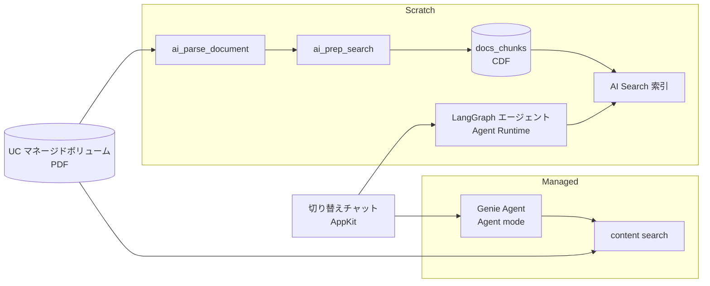

# 非構造データ分析 RAG エージェント ハンズオン

同じ PDF を使って、RAG エージェントを2つの実装パターンで作り、違いを体験するハンズオンである。

| パターン | 作り方 | 主な機能 |
|---|---|---|
| **Scratch** | ノートブックのコードで作る | `ai_parse_document`、`ai_prep_search`、AI Search、LangGraph、MLflow、Agent Bricks CLI（Agent Runtime on Databricks Apps） |
| **Managed** | 画面の操作だけで作る | Genie Agent（Agent mode）、ボリュームの content search、Genie One |

> 2026年10月時点で、ボリュームの解析（content search）、`ai_prep_search`、Agent Bricks CLI などは **Beta** である。実行前に各ドキュメントで最新の状態を確かめる。

## ファイル構成

| パス | 内容 | 所要時間の目安 |
|---|---|---|
| `00-0_代表者_共通エンドポイントの作成.ipynb` | **代表者だけが実行する**。全員で共有する AI Search エンドポイントを作り、参加者に権限を付ける | 10分 |
| `00_データ準備.ipynb` | カタログ（任意）・自分のスキーマ・マネージドボリュームを作り、PDF を置く | 5分 |
| `1-1_Scratch_パースとAI Search索引の作成.ipynb` | PDF のパース、チャンク化、共通のエンドポイントへの自分の索引の作成、ANN とハイブリッドの検索 | 30分 |
| `1-2_Scratch_RAGエージェントの構築とデプロイ.ipynb` | エージェントの試作、MLflow のトレースと評価、Agent Bricks CLI でのデプロイ | 45分 |
| `2_Managed_Genie AgentとContent Search.ipynb` | Genie Agent の作成と Agent mode での質問（画面操作のガイド） | 30分 |
| `agent/` | Agent Bricks のプロジェクト（1-2 でデプロイする） | — |
| `3_切り替えアプリのデプロイ.ipynb` | （任意）2つのエージェントを切り替えて比べるアプリを、Databricks の画面からデプロイする（画面操作のガイド） | 20分 |
| `apps/rag-handson-switcher/` | 3 でデプロイするチャットアプリ（AppKit）のコード | — |

## 前提条件

- Unity Catalog が有効なワークスペース。AWS の Tokyo など、content search をリージョン内で処理できるリージョン（[対応リージョン](https://docs.databricks.com/aws/ja/genie-agents/volumes)）
- ワークスペース管理者が **プレビュー** で「Analyze Files in Volumes with Genie Agents」を有効にしている（Managed パターン）
- 参加者に **Workspace access** と **Databricks SQL access** の entitlement がある
- サーバーレスのノートブック（環境バージョン 4 で動作確認）、サーバーレスの SQL ウェアハウス
- Foundation Model API の `databricks-qwen3-embedding-0-6b`（埋め込み）と、Claude などの LLM
- 参加者：カタログの `USE CATALOG` と `CREATE SCHEMA`、Databricks Apps を作る権限
- 代表者：AI Search エンドポイントを作る権限。参加者は共通のエンドポイントの「使用可能」（CAN USE）の権限をもらう（00-0 で付ける）

## 共有するものと参加者ごとのもの

| もの | 単位 | 作る人 |
|---|---|---|
| カタログ | 全員で共有してよい | 管理者 |
| AI Search エンドポイント | **全員で1つ**（索引は1つのエンドポイントに 50 まで） | 代表者（00-0） |
| スキーマ（ボリューム・テーブル・索引） | **参加者ごと**。既定は `rag_handson_<ユーザー名>` | 参加者（00、1-1） |
| エージェントのアプリ | 参加者ごと（`AGENT_NAME` を重ならない名前にする） | 参加者（1-2） |

## ノートブックのインポート（Git フォルダー）

1. 左サイドバーの「ワークスペース」で、取り込み先のフォルダー（例：自分のホーム）を開く
2. 右上の「作成」→「Git フォルダー」をクリックする
3. 「Git リポジトリの URL」に `https://github.com/skato-db/databricks-rag-handson.git` を入力し、Git プロバイダー（GitHub）とフォルダー名を確かめて「Git フォルダーを作成」をクリックする

> このリポジトリは private である。取り込むには、リポジトリへのアクセス権と、ワークスペースの Git 資格情報（「設定」→「リンクされたアカウント」で GitHub を連携）が必要である。

取り込んだフォルダーの中で、ノートブックを番号の順に開く。各ノートブックの上部の widget でカタログ名などを自分の環境に合わせ、上のセルから順に実行する。

## 実行順

0. （代表者だけ）`00-0_代表者_共通エンドポイントの作成` — ハンズオンの10分以上前に実行し、エンドポイントの名前を参加者に伝える
1. `00_データ準備` — widget の `CATALOG_NAME` を使うカタログにする。`SCHEMA_NAME` は自動で自分用の名前になる
2. `1-1_Scratch_...` — 00 と同じカタログ・スキーマを指定し、`AI_SEARCH_ENDPOINT` に代表者から伝えられた名前を入れる
3. `1-2_Scratch_...` — `AGENT_NAME` は参加者ごとに重ならない名前にする。デプロイは Web Terminal で行う
4. `2_Managed_...` — 画面の操作でGenie Agent を作る
5. （任意）`3_切り替えアプリのデプロイ` — 1-2 と 2 で作ったエージェントを切り替えて比べるアプリを、画面の操作でデプロイする

## 切り替えチャットアプリ（任意）

`apps/rag-handson-switcher` は AppKit（TypeScript/React）のアプリである。どちらのタブも、**質問したユーザー本人の権限**（user authorization）で呼ぶ。

- **Scratch**：1-1 の AI Search 索引をハイブリッド検索し、1-2 のエージェントと同じシステムプロンプト・同じ LLM で回答を作る（スコープ `vector-search`、`model-serving`）。アプリから別のアプリ（1-2 の Agent Runtime）を呼ぶと利用者のトークンが引き継がれないため、エージェントのアプリは呼ばない
- **Managed**：Genie Agent の Agent mode API を呼ぶ（スコープ `genie`）

### デプロイの手順

**`3_切り替えアプリのデプロイ`** に、画像付きの手順がある。Databricks の画面の操作だけで行い、ローカル PC や Web Terminal は使わない。流れは次のとおり。

1. Databricks Apps の画面で、カスタムアプリを作る（名前は参加者ごとに重ならないものにする）
2. アプリのリソースに自分の AI Search 索引（リソースキー `vector-search-index`）を、ユーザー認証のスコープに `genie`・`model-serving`・`vector-search` を追加する
3. 「デプロイ」で、Git フォルダーの中の `apps/rag-handson-switcher` を指定する
4. アプリを開いて同意し、Managed タブに Genie Agent の URL を貼る

## 後片付け

作ったものを、作った順と逆に消す。共通のエンドポイントは、**全員が終わってから代表者が最後に** 消す。

| 対象 | 消し方 |
|---|---|
| 切り替えアプリ | Databricks Apps でアプリを開き、「⋮」→「Delete」 |
| Scratch のエージェント | Web Terminal で `agentbricks deployments delete agent-bricks-<AGENT_NAME> --delete-source` |
| Genie Agent | Genie の一覧で該当の Genie Agent を削除する |
| MLflow エクスペリメント | 「エクスペリメント」で `rag-handson-agent` を削除する |
| 自分のスキーマ（テーブル・ボリューム・索引） | 中身を確かめてから `DROP SCHEMA <カタログ>.<自分のスキーマ> CASCADE`。索引もスキーマと一緒に消える |
| （代表者）共通の AI Search エンドポイント | 全員がスキーマを消したあと、00-0 の「後片付け」のセルで削除する |

## サンプルデータ

サンプルの PDF は、VDA QMC が公開している「Automotive SPICE® PAM 4.0 日本語版」である。リポジトリには含めず、`00_データ準備` が公式の URL からダウンロードする。内容に疑義がある場合は、www.vda-qmc.de の英語版が正とされている。別の PDF を使うときは、`00_データ準備` の widget で URL とファイル名を変え、1-2 の評価データセットを書き換える。
